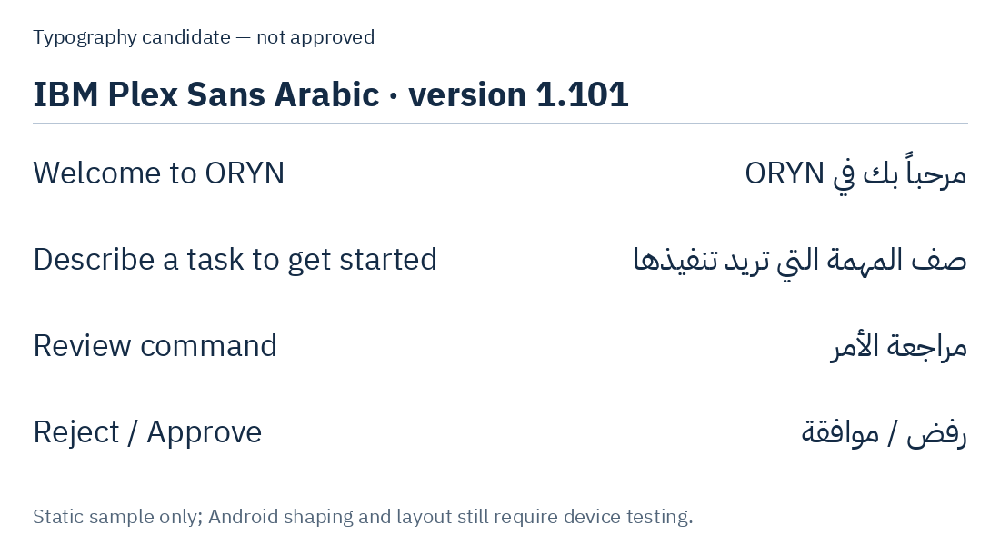

# M1-02 — AI Agent typography, Arabic/RTL and visual design review

**Status: DESIGN PROPOSAL — NOT YET APPROVED.**  
**Prepared:** 2026-11-09  
**Baseline:** merged [PR #26](https://github.com/MohammedTeir/oryn-ai-agent/pull/26), commit `44c00531ff09201274b1552868eef91108388e80`.  
**Requirements:** [Master specification v1.10](../../ORYN_Master_Project_Specification.md) §§0, 3–4 and UI Acceptance Tests, [M1-02 task](../milestone-1-tasks.md#m1-02--ai-agent-designrtl-approval-gate), [component contract](components.md), [tokens](tokens.json), [AGENTS.md](../../AGENTS.md).

This is **a review specification and content wireframe**, not a finished graphical mockup, selected font dependency, UI code, design approval or device acceptance. No existing brand artwork, Kotlin/native grant gateway, preview behavior or production claims change in this PR.

## Approved references / do not redraw

Existing [brand asset package](../../assets/ORYN_Brand_Assets/README.md) says the owner approved the asset family on 2026-11-01, but its README lists `v3.0` original-design filenames **not present** in the actual `00_Original_Approved_Designs/Approved_Designs/` directory. That directory currently contains the **`v1.0`-named** AI Agent, Settings, Terminal and Tools images plus the `v1.2` design-system and `v1.3` execution-flow sheets. The references below were verified against the actual directory listing. Do not infer the design revision from a filename or silently claim the missing `v3.0` assets exist.

- `assets/ORYN_Brand_Assets/00_Original_Approved_Designs/Approved_Designs/oryn-ai-agent-v1.0-approved.png` — AI Agent layout **first**.
- `.../Approved_Designs/oryn-design-system-components-v1.2-approved.png` — original Light Mode design system.
- `.../Approved_Designs/oryn-ui-states-execution-flow-v1.3-approved.png` — component reference only; never display mutually exclusive states simultaneously.
- Later, individually review original approved `oryn-settings-v1.0-approved.png`, `oryn-terminal-tools-v1.0-approved.png` and `oryn-tools-tab-v1.0-approved.png`. Do not redesign those screens before review.
- Canonical implementation assets: `03_Icon_Only/oryn-icon-only-transparent.png` and `04_Monochrome/oryn-icon-only-mono-navy.png`; PNG master lineage wins over approximate traced SVGs. Do not edit `00_Original_Approved_Designs/`.

**Brand metadata issue:** package README calls an earlier source icon a technical “candidate” while later QA entries and opening statement describe owner approval of the v3 family. Do not silently resolve any remaining approval ambiguity by inventing new artwork. Existing app preview already uses the icon-only master; verify its clarity at **24 dp** on the phone.

**Header wordmark issue:** the canonical primary logo includes a tagline, which cannot be legible under the 12 sp minimum if squeezed into the header. The preview uses the approved symbol alongside text `ORYN`. Keep that temporary combination and seek an **approved tagline-free wordmark asset** rather than cropping, tracing, recoloring or replacing the canonical brand artwork.

## Typography candidate — pending explicit approval

**Recommendation to review:** **IBM Plex Sans Arabic** as one family for Arabic and English. The exact candidate files examined below contain the characters in the proposed sample copy; this is not a claim of complete coverage for every language, arbitrary command, or future interface string. The family remains **unapproved** and Android rendering remains unverified.

Source/rights evidence: the exact Google Fonts files at commit [`702964cf46bd1bf33d0745d24bbaac33edf8b8af`](https://github.com/google/fonts/tree/702964cf46bd1bf33d0745d24bbaac33edf8b8af/ofl/ibmplexsansarabic) include an [SIL Open Font License 1.1](https://github.com/google/fonts/blob/702964cf46bd1bf33d0745d24bbaac33edf8b8af/ofl/ibmplexsansarabic/OFL.txt), copyright IBM Corp., with the reserved font name “Plex”. The license permits use and redistribution under its conditions; any distribution must include the applicable copyright and license notice, and modified versions must respect the reserved-name conditions. Review the license itself before distribution. The pinned upstream [investigation](https://github.com/google/fonts/blob/702964cf46bd1bf33d0745d24bbaac33edf8b8af/ofl/ibmplexsansarabic/upstream_info.md) identifies these as precompiled Google Fonts files, with no buildable sources at its referenced source commit.

| Exact candidate file, version 1.101 | SHA-256 |
| --- | --- |
| `IBMPlexSansArabic-Regular.ttf` | `6f611412270a132bbac838da9259d4c68569b4175f3b3b8fa3fa36a30b56dab9` |
| `IBMPlexSansArabic-SemiBold.ttf` | `597bd5502e5997be4414e4c9c88834b30ff3784250c84f20bce2b20e53ebd467` |
| `IBMPlexSansArabic-Bold.ttf` | `691e0c891a38637ae6bbdb69700f8042cb0724a137bee615068ffdb92244f61f` |

On 2026-11-09, fontTools `TTFont.getBestCmap()` found every non-whitespace character in the 28 English and Arabic sample strings below in each of these three files. Each also contains `arab` and `latn` GSUB script entries. This is a character-map inspection, **not** proof of Arabic shaping, visual quality, accessibility or complete Unicode coverage on Android; test actual strings, mixed-direction text, fallback, selected weights and device rendering before approval. Do not assume other files or versions have identical coverage.

**No font files are included in this proposal PR** and no font family is inserted into `tokens.json` yet. Do not assume font rendering on Android 10/11+ or licensed redistributability of any alternative font without inspection.

### Typography review samples

This sample was rendered from the pinned Regular and Bold files above using Pillow with RAQM. It is a typography sample only, not an Android screenshot or an approved screen design.

| Purpose | English | Arabic |
| --- | --- | --- |
| AI Agent title | AI Agent | الوكيل الذكي |
| Welcome | Welcome to ORYN | مرحباً بك في ORYN |
| Empty state | Describe a task to get started | صف المهمة التي تريد تنفيذها |
| Composer hint | What would you like ORYN to do? | ما المهمة التي تريد من ORYN تنفيذها؟ |
| History | History | السجل |
| Settings | Settings | الإعدادات |
| Connection unknown | Unknown | غير معروف |
| Connection permission | Permission required | الإذن مطلوب |
| No task | No tasks yet | لا توجد مهام بعد |
| Approval review | Review command | مراجعة الأمر |
| Example status | Example only — cannot execute | مثال فقط — لا يمكن تنفيذه |
| Details | Details | التفاصيل |
| More options | More approval options | المزيد من خيارات الموافقة |
| Reject / Approve | Reject / Approve | رفض / موافقة |

These strings are **design-copy proposals**. Actual screen strings must use the application's bilingual i18n layer; no mocks or demo execution values may enter a production state.

## Proposed AI Agent layout contract (not an image)

### Small-screen header: 360 dp and 200% font scale

- Start edge: official ORYN symbol + a **tagline-free approved wordmark**. Temporary preview text `ORYN` is acceptable only while the official asset is unresolved.
- End edge: one compact runtime/connection chip (state is native-observed), History and Settings; **History and Settings tap areas each at least 48 dp**.
- No third primary tab; no tagline. Never shrink required tap targets, hide state text or clip the wordmark in order to fit.
- Responsive overflow may contain **secondary** actions; must **not** silently remove the required History, Settings or connection affordance. Use explicit measurement/screenshots to resolve width conflicts. The 360 dp/200% combination is an **acceptance test, not something the current preview has passed**.
- Current preview inspection: History and Settings declare the tokenized minimum touch target, but the connection caption uses `numberOfLines={1}` with shrinking. At large text sizes it may truncate; measure the actual UI on the target phone before deciding the layout. The code declarations alone do not prove the visible targets or text pass device acceptance.

### AI Agent content — empty

1. Header with current observed connection status; on an untested backend, display `Unknown` / `غير معروف`, never `Connected`.
2. Clearly identified empty state: ORYN symbol, a short onboarding line, optional non-executable suggestions only if explicitly labeled as suggestions.
3. Task composer with accessible focus and send control; in the eventual production app, submitting a task must not dispatch shell commands or claim LLM output before a valid provider response.
4. Compact queue count/list **only from real persisted tasks**, never hardcoded demo numbers.
5. Exactly two bottom tabs: **AI Agent** and **Terminal & Tools**. The second tab contains an internal Terminal / Tools / History segmented control, not another primary navigation destination.

### Approval sheet (review-only fixture until native security integration)

- Summary always shows the **complete, expandable exact command**, text-labeled risk, and effects: root, network, deletion and writes outside the workspace. Do not hide decision-relevant facts in Details.
- Details covers executable/args, backend, working directory, privilege, environment **variable names only**, filesystem/network effects and timeout.
- Strict is initially selected for the *design example*; Batch and Session choices are only enabled once their immutable scopes can be **natively enforced**. Root/high-risk needs independent exact-action review.
- Approve/Reject stay pinned within scrolling content; fixture decisions remain **disabled** and cannot reach the native gateway.
- Arabic prose follows RTL, but exact executable/arguments/paths/logs (e.g. `echo ORYN`) render as isolated **LTR** code with copy/select behavior. Layout mirroring must never mutate the actual command string.

## RTL and icon mirroring matrix

| Element | Arabic RTL behavior | Verification |
| --- | --- | --- |
| Back arrow / directional chevron | Mirror direction | Test navigation/back and accessible announcement |
| Main row ordering / alignment | Use logical start/end, do not hardcode left/right | Test at 360 dp and 200% font |
| ORYN logo/icon and text wordmark | **Never mirror** | Preserve canonical shape and order |
| Play, Stop, Retry glyphs | **Never mirror** | Test semantics, not just screenshots |
| Terminal commands, paths, stdout/stderr, IDs | Isolate LTR and ensure text selection | Test mixed Arabic/Latin and punctuation |
| Running/Unknown labels | Localize through i18n, never color only | Test real backend unknown and stale observations |
| Connection icon | Plug/Unplug or Link/Unlink, **not Wi-Fi** | Keep text label with icon |
| Root indicator | KeyRound or ShieldCheck + explicit root text, **not fingerprint** | Test legend and accessibility |
| ORYN AI Agent tab image | Approved master only, **24 dp real-device check** | Ask owner for official variant only if illegible |

## Approval review checklist (all open)

- [ ] Confirm **one licensed Arabic+Latin font family**, exact assets and observed glyph coverage, weights/variants and correct Android rendering.
- [ ] Review **English and Arabic AI Agent empty-state and active-chat** mockups derived from the approved 2026-11-01 design. This markdown wireframe is not a finished mockup.
- [ ] Approve **tagline-free ORYN header wordmark asset** or an explicitly sanctioned alternative; do not redraw approved art.
- [ ] Approve AI Agent header behavior at **360 dp / 200% text** after phone screenshots.
- [ ] Verify ORYN bottom-tab mark at **24 dp** on phone, record legibility.
- [ ] Review Arabic approval-card summary vs Details, pinned disabled controls and mixed-script command isolation.
- [ ] Separately review RTL onboarding, Terminal & Tools and Settings mockups *after the AI Agent design gate*.
- [ ] Record user approval and explicit device results before marking M1-02 complete or finalizing typography in design tokens.

## Next decision

For **M1-02**, request the owner's explicit approval/rejection of IBM Plex Sans Arabic as the preferred typography family (subject to real glyph/Android QA), and confirmation that the existing source AI Agent screen remains the layout reference. If a tagged/approved tagline-free wordmark does not exist, prepare a **separate owner-approved brand deliverable**, not an unauthorized crop or trace.

M1-01 language-selection smoke evidence is recorded separately in [the device verification register](../feasibility/milestone-1-language-device-verification.md). **Do not infer M1-01 full closure from that limited report.**
